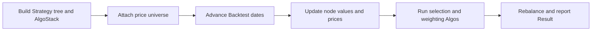
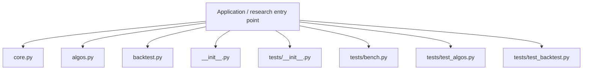
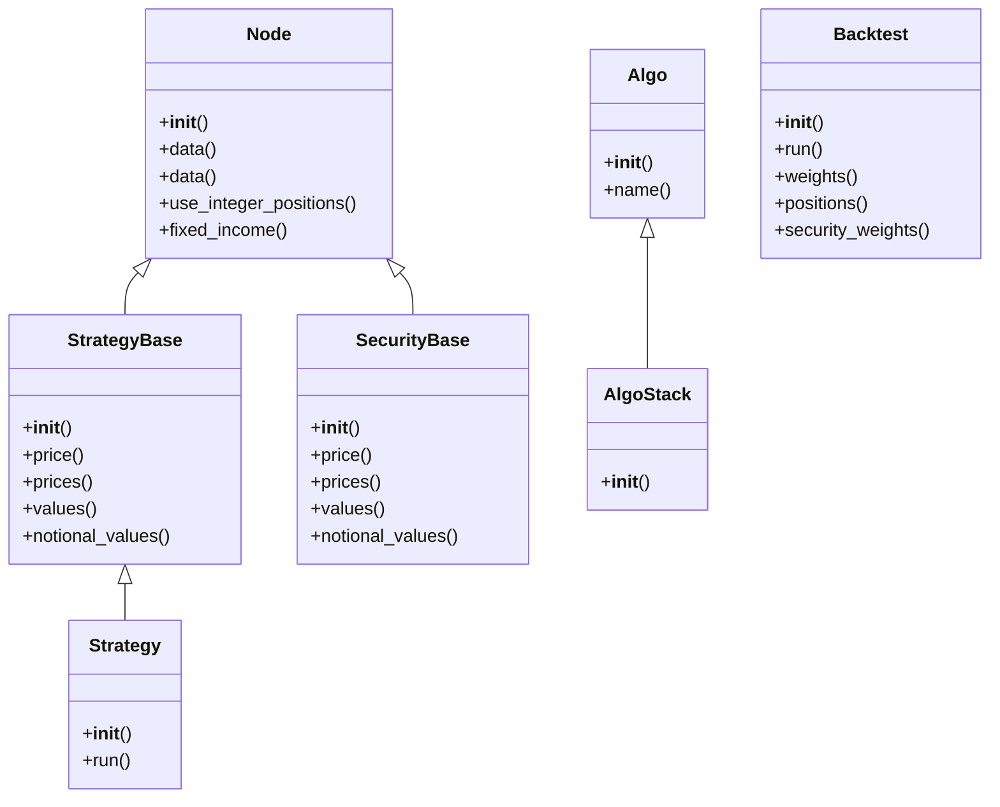
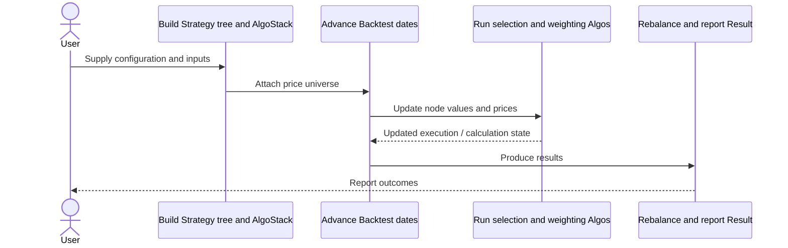
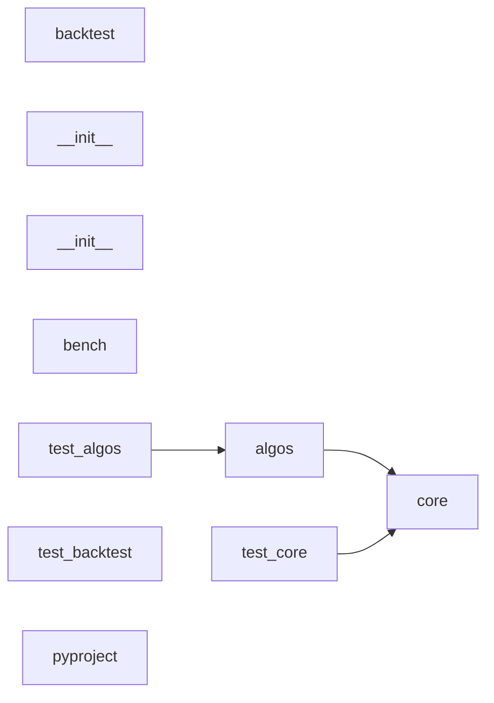
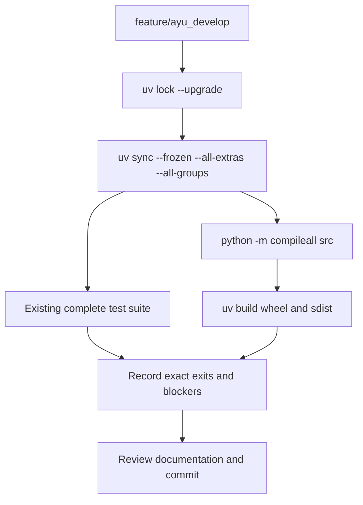

# bt: development, architecture and operations

Updated 2026-10-12 on `feature/ayu_develop`; source snapshot `f75875cad03e`. This guide follows the source in this checkout and separates available interfaces from verification evidence.

## Purpose and feature boundaries

Composable portfolio backtesting with hierarchical strategy/security nodes, short-circuiting algorithm stacks, allocation, rebalancing and ffn result analysis.

Node implements the shared hierarchy. StrategyBase holds capital and child nodes; SecurityBase models leaf positions. AlgoStack passes temporary and persistent strategy state through reusable algorithms. Backtest supplies dates and prices; Result delegates financial statistics to ffn. The upstream hatch-cython wheel hook compiles core.py while keeping a pure-Python source distribution.

## Main workflow

The following is the repository-specific logical workflow. Runtime execution details remain in the linked source and the validation record.

1. Build Strategy tree and AlgoStack.
2. Attach price universe.
3. Advance Backtest dates.
4. Update node values and prices.
5. Run selection and weighting Algos.
6. Rebalance and report Result.

## Components and ownership

The entry point composes the source modules below; arrows indicate review/navigation boundaries rather than a claim that every module is called in every run.

| Source | Declared classes / functions | Implementation role |
|---|---|---|
| [src/bt/core.py](../src/bt/core.py) | Node, StrategyBase, SecurityBase, Security, FixedIncomeSecurity, CouponPayingSecurity; is_zero | Contains the core building blocks of the framework. |
| [src/bt/algos.py](../src/bt/algos.py) | PrintDate, PrintTempData, PrintInfo, Debug, RunOnce, RunPeriod; run_always, _select_by_price, _validate_transaction_security, _transaction_quantity_is_noop | A collection of Algos used to create Strategy logic. |
| [src/bt/backtest.py](../src/bt/backtest.py) | Backtest, Result, RandomBenchmarkResult, RenormalizedFixedIncomeResult; run, benchmark_random | Contains backtesting logic and objects. |
| [src/bt/__init__.py](../src/bt/__init__.py) | Package data / configuration | See the public declarations and implementation linked here. |
| [tests/__init__.py](../tests/__init__.py) | Package data / configuration | See the public declarations and implementation linked here. |
| [tests/bench.py](../tests/bench.py) | benchmark_1, benchmark_2, benchmark_3 | Performance benchmarks |
| [tests/test_algos.py](../tests/test_algos.py) | DummyAlgo; test_algo_name, test_algo_stack, test_print_temp_data, test_print_info | See the public declarations and implementation linked here. |
| [tests/test_backtest.py](../tests/test_backtest.py) | test_backtest_copies_strategy, test_backtest_dates_set, test_backtest_rejects_unsorted_dates, test_backtest_accepts_monotonic_duplicate_dates | See the public declarations and implementation linked here. |
| [tests/test_core.py](../tests/test_core.py) | DeterministicHashString; test_data_and_history_stay_current_after_numpy_read, test_setup_resets_bidoffer_mode, test_security_without_universe_prices_preserves_missing_history, test_node_tree1 | See the public declarations and implementation linked here. |
| [pyproject.toml](../pyproject.toml) | Package data / configuration | See the public declarations and implementation linked here. |
| [hatch_build.py](../hatch_build.py) | CustomBuildHook | Hatch build hook for Cython compilation. |

## Class design

Methods and inheritance edges are taken from the selected declarations in the actual source. A missing edge means composition or an external base is not asserted here.

## End-to-end interaction

This sequence presents the responsibilities of the main workflow, including the state/result boundary. The linked classes and functions provide the exact method-level contract.

## Source dependency direction

These edges are actual explicit imports between the selected source modules. Dynamic imports, re-exports and third-party internals are omitted.

## Design details and extension points

### `Node`

Source: [src/bt/core.py](../src/bt/core.py).

The Node is the main building block in bt's tree structure design.
Both StrategyBase and SecurityBase inherit Node. It contains the
core functionality of a tree node.

- `data`: See implementation for the complete contract.
- `data`: See implementation for the complete contract.
- `use_integer_positions`: Set indicator to use (or not) integer positions for a given strategy or security.
- `fixed_income`: Whether the node is a fixed income node (using notional weighting).
- `prices`: A TimeSeries of the Node's price.

### `StrategyBase`

Source: [src/bt/core.py](../src/bt/core.py).

Strategy Node. Used to define strategy logic within a tree.
A Strategy's role is to allocate capital to it's children
based on a function.

- `price`: Current price.
- `prices`: TimeSeries of prices.
- `values`: TimeSeries of values.
- `notional_values`: TimeSeries of notional values.
- `capital`: Current capital - amount of unallocated capital left in strategy.

### `SecurityBase`

Source: [src/bt/core.py](../src/bt/core.py).

Security Node. Used to define a security within a tree.
A Security's has no children. It simply models an asset that can be bought
or sold.

- `price`: Current price.
- `prices`: TimeSeries of prices.
- `values`: TimeSeries of values.
- `notional_values`: TimeSeries of notional values.
- `position`: Current position

### `Algo`

Source: [src/bt/core.py](../src/bt/core.py).

Algos are used to modularize strategy logic so that strategy logic becomes
modular, composable, more testable and less error prone. Basically, the
Algo should follow the unix philosophy - do one thing well.

- `name`: Algo name.

### `AlgoStack`

Source: [src/bt/core.py](../src/bt/core.py).

An AlgoStack derives from Algo runs multiple Algos until a
failure is encountered.

### `Strategy`

Source: [src/bt/core.py](../src/bt/core.py).

Strategy expands on the StrategyBase and incorporates Algos.

- `run`: See implementation for the complete contract.

### `Backtest`

Source: [src/bt/backtest.py](../src/bt/backtest.py).

A Backtest combines a Strategy with data to
produce a Result.

- `run`: Runs the Backtest.
- `weights`: DataFrame of each component's weight over time
- `positions`: DataFrame of each component's position over time
- `security_weights`: DataFrame containing weights of each security as a percentage of the whole portfolio over time
- `herfindahl_index`: Calculate Herfindahl-Hirschman Index (HHI) for invested securities. For each day, signed security values (notionals for fixed income) are normalized by total absolute security exposure before they are squared and summed. Cash is excluded, so HHI varies from 1/N for N equally exposed securities to 1

## Repository layout and resources

Installable packages live under `src/`. `pyproject.toml` defines package metadata, build requirements, optional integrations and development dependencies; `uv.lock` records resolved versions, and `.python-version` selects the local interpreter. This layout keeps an accidental checkout import from substituting for the installed wheel. Package resources remain beside their owning modules and are included by the build backend. Existing upstream examples, fixtures, scripts and documentation retain their separate roles.

## Maintenance compatibility and evidence

- The current Cython wheel hook discovers src/bt via setuptools package-dir. Pandas column initialization uses loc to avoid copy-on-write chained-assignment warnings.
- Empty/all-NaN benchmark histogram data is explicitly rejected with ValueError before density normalization; the existing cases preserve that behavior.
- Verified licensed ffn 1.4.1 source handles total-loss log returns as -inf and undefined below-total-loss values as NaN without warning filters. See vendor/ffn/PROVENANCE.md.
- mdformat is capped below0.8 because current mdformat-tables 1.0.0 requires that API family. Python 3.15 actual source installation succeeds.

## Development and verification workflow

See [development commands](development.md) and [validation evidence](validation.md) for interpreter selection, dependency exceptions, full-suite results and remaining blockers. No additional test cases were introduced by this maintenance.
