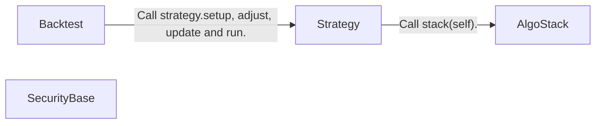
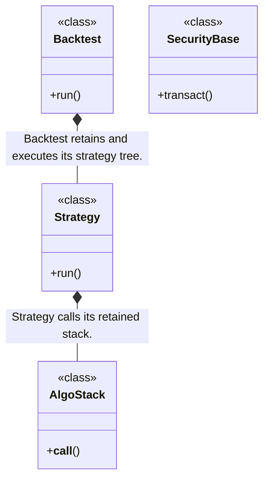
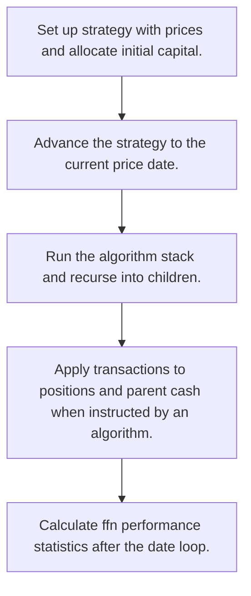
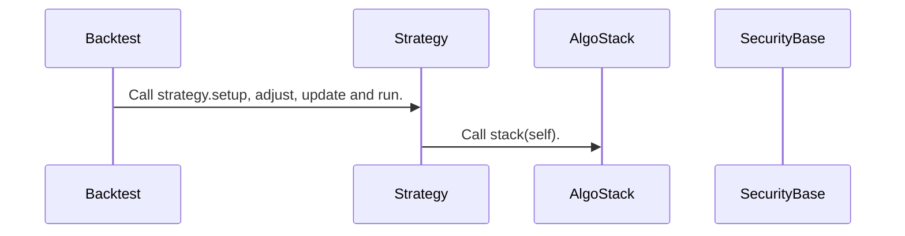

# bt: workflow, design and architecture

Updated: **2026-10-13**
Reviewed Git hash: `63075945aa2c51b5aeef66e6b118c1f8b4ec7190`
Branch: `feature/ayu_develop`
Source diff SHA256: `e3b0c44298fc1c149afbf4c8996fb92427ae41e4649b934ca495991b7852b855`
Scope: **Portfolio strategy backtesting library** / Maintenance: **active**
Languages: Python

[HTML edition](ayu-develop.html) / [Development](development.md) / [Historical validation](validation.md) / [Full system comparison](../../docs/index.html)

## Purpose and scope

Simulate a tree of portfolio strategies and securities using composable algorithms and date-indexed prices.

## Features and support boundaries

Native = implemented here. Integration = supplied through a named host/API. Limited = material restriction. Not provided = evidenced scope exclusion. Unverified = support/absence not established. Not applicable = outside this artifact type.

| Capability | Status | Implementation and limits | Source |
|---|---|---|---|
| Backtesting | Native | Runs a funded strategy over historical price dates. | [Backtest.run](../src/bt/backtest.py) ([L408](https://github.com/alexcwyu/bt/blob/63075945aa2c51b5aeef66e6b118c1f8b4ec7190/src/bt/backtest.py#L408)) |
| Live execution | Unverified | The inspected source does not establish this capability. This is not a claim of absence. | Not applicable to this repository scope. |
| Paper trading | Unverified | The inspected source does not establish this capability. This is not a claim of absence. | Not applicable to this repository scope. |
| Event driven | Limited | Date-loop updates with strategy algorithms. No async event bus in this flow. | [Backtest.run](../src/bt/backtest.py) ([L408](https://github.com/alexcwyu/bt/blob/63075945aa2c51b5aeef66e6b118c1f8b4ec7190/src/bt/backtest.py#L408)) / [Strategy.run](../src/bt/core.py) ([L2267](https://github.com/alexcwyu/bt/blob/63075945aa2c51b5aeef66e6b118c1f8b4ec7190/src/bt/core.py#L2267)) |
| Vectorized | Limited | Price frames and analytics are array-oriented, but state and strategies advance by date. | [Backtest.run](../src/bt/backtest.py) ([L408](https://github.com/alexcwyu/bt/blob/63075945aa2c51b5aeef66e6b118c1f8b4ec7190/src/bt/backtest.py#L408)) |
| Order management | Limited | Security transact changes positions and cash directly. It is not a live exchange order lifecycle. | [SecurityBase.transact](../src/bt/core.py) ([L1762](https://github.com/alexcwyu/bt/blob/63075945aa2c51b5aeef66e6b118c1f8b4ec7190/src/bt/core.py#L1762)) |
| Order types | Limited | Transaction quantity and optional custom price with bid-offer accounting, rather than exchange order types. | [SecurityBase.transact](../src/bt/core.py) ([L1762](https://github.com/alexcwyu/bt/blob/63075945aa2c51b5aeef66e6b118c1f8b4ec7190/src/bt/core.py#L1762)) |
| Multi venue | Unverified | The inspected source does not establish this capability. This is not a claim of absence. | Not applicable to this repository scope. |
| Crypto | Unverified | The inspected source does not establish this capability. This is not a claim of absence. | Not applicable to this repository scope. |
| Equities | Unverified | The inspected source does not establish this capability. This is not a claim of absence. | Not applicable to this repository scope. |
| Futures | Unverified | The inspected source does not establish this capability. This is not a claim of absence. | Not applicable to this repository scope. |
| Options | Unverified | The inspected source does not establish this capability. This is not a claim of absence. | Not applicable to this repository scope. |
| Forex | Unverified | The inspected source does not establish this capability. This is not a claim of absence. | Not applicable to this repository scope. |
| Strategy api | Native | AlgoStack composes callable algorithms in a strategy tree. | [Strategy.run](../src/bt/core.py) ([L2267](https://github.com/alexcwyu/bt/blob/63075945aa2c51b5aeef66e6b118c1f8b4ec7190/src/bt/core.py#L2267)) / [AlgoStack.__call__](../src/bt/core.py) ([L2209](https://github.com/alexcwyu/bt/blob/63075945aa2c51b5aeef66e6b118c1f8b4ec7190/src/bt/core.py#L2209)) |
| Optimization | Unverified | The inspected source does not establish this capability. This is not a claim of absence. | Not applicable to this repository scope. |
| Machine learning | Unverified | The inspected source does not establish this capability. This is not a claim of absence. | Not applicable to this repository scope. |
| Reinforcement learning | Unverified | The inspected source does not establish this capability. This is not a claim of absence. | Not applicable to this repository scope. |
| Portfolio | Native | Strategy trees and child securities carry positions, values and cash. | [Strategy.run](../src/bt/core.py) ([L2267](https://github.com/alexcwyu/bt/blob/63075945aa2c51b5aeef66e6b118c1f8b4ec7190/src/bt/core.py#L2267)) / [SecurityBase.transact](../src/bt/core.py) ([L1762](https://github.com/alexcwyu/bt/blob/63075945aa2c51b5aeef66e6b118c1f8b4ec7190/src/bt/core.py#L1762)) |
| Risk management | Limited | Fees, bid-offer costs and bankruptcy stop behavior. Risk selection can be expressed in algorithms. | [Backtest.run](../src/bt/backtest.py) ([L408](https://github.com/alexcwyu/bt/blob/63075945aa2c51b5aeef66e6b118c1f8b4ec7190/src/bt/backtest.py#L408)) / [SecurityBase.transact](../src/bt/core.py) ([L1762](https://github.com/alexcwyu/bt/blob/63075945aa2c51b5aeef66e6b118c1f8b4ec7190/src/bt/core.py#L1762)) |
| Performance analytics | Integration | Backtest computes performance through ffn calc_perf_stats. | [Backtest.run](../src/bt/backtest.py) ([L408](https://github.com/alexcwyu/bt/blob/63075945aa2c51b5aeef66e6b118c1f8b4ec7190/src/bt/backtest.py#L408)) |
| Historical data | Limited | Caller-supplied date-indexed price and additional-data frames. | [Backtest.run](../src/bt/backtest.py) ([L408](https://github.com/alexcwyu/bt/blob/63075945aa2c51b5aeef66e6b118c1f8b4ec7190/src/bt/backtest.py#L408)) |
| Streaming data | Unverified | The inspected source does not establish this capability. This is not a claim of absence. | Not applicable to this repository scope. |
| Persistence | Unverified | The inspected source does not establish this capability. This is not a claim of absence. | Not applicable to this repository scope. |
| Data pipeline | Unverified | The inspected source does not establish this capability. This is not a claim of absence. | Not applicable to this repository scope. |
| Web ui | Unverified | The inspected source does not establish this capability. This is not a claim of absence. | Not applicable to this repository scope. |
| Cli | Unverified | The inspected source does not establish this capability. This is not a claim of absence. | Not applicable to this repository scope. |
| Monitoring | Unverified | The inspected source does not establish this capability. This is not a claim of absence. | Not applicable to this repository scope. |
| Extension api | Native | Callable AlgoStack elements and recursive strategy children. | [Strategy.run](../src/bt/core.py) ([L2267](https://github.com/alexcwyu/bt/blob/63075945aa2c51b5aeef66e6b118c1f8b4ec7190/src/bt/core.py#L2267)) / [AlgoStack.__call__](../src/bt/core.py) ([L2209](https://github.com/alexcwyu/bt/blob/63075945aa2c51b5aeef66e6b118c1f8b4ec7190/src/bt/core.py#L2209)) |
| Native acceleration | Unverified | The inspected source does not establish this capability. This is not a claim of absence. | Not applicable to this repository scope. |
| Distributed execution | Unverified | The inspected source does not establish this capability. This is not a claim of absence. | Not applicable to this repository scope. |

## System components

| Component | Responsibility | Source |
|---|---|---|
| Backtest | Historical date loop, funding and results. | [Backtest.run](../src/bt/backtest.py) ([L408](https://github.com/alexcwyu/bt/blob/63075945aa2c51b5aeef66e6b118c1f8b4ec7190/src/bt/backtest.py#L408)) |
| Strategy | Hierarchical strategy execution. | [Strategy.run](../src/bt/core.py) ([L2267](https://github.com/alexcwyu/bt/blob/63075945aa2c51b5aeef66e6b118c1f8b4ec7190/src/bt/core.py#L2267)) |
| AlgoStack | Composable selection, weighting and rebalance pipeline. | [AlgoStack.__call__](../src/bt/core.py) ([L2209](https://github.com/alexcwyu/bt/blob/63075945aa2c51b5aeef66e6b118c1f8b4ec7190/src/bt/core.py#L2209)) |
| SecurityBase | Security position and transaction accounting. | [SecurityBase.transact](../src/bt/core.py) ([L1762](https://github.com/alexcwyu/bt/blob/63075945aa2c51b5aeef66e6b118c1f8b4ec7190/src/bt/core.py#L1762)) |

## Architecture and component boundaries

The component view summarizes inspected responsibility boundaries. Arrows identify the documented API/data dependencies; this is not a deployment-readiness claim.

- Call strategy.setup, adjust, update and run.: [Backtest.run](../src/bt/backtest.py) ([L408](https://github.com/alexcwyu/bt/blob/63075945aa2c51b5aeef66e6b118c1f8b4ec7190/src/bt/backtest.py#L408))
- Call stack(self).: [Strategy.run](../src/bt/core.py) ([L2267](https://github.com/alexcwyu/bt/blob/63075945aa2c51b5aeef66e6b118c1f8b4ec7190/src/bt/core.py#L2267))

## Design decisions

| Decision | Rationale | Tradeoff | Evidence |
|---|---|---|---|
| A tree models portfolios and nested strategies. | Each node participates in shared update and transaction accounting. | Execution is date-based and direct transaction accounting rather than venue messaging. | [Strategy.run](../src/bt/core.py) ([L2267](https://github.com/alexcwyu/bt/blob/63075945aa2c51b5aeef66e6b118c1f8b4ec7190/src/bt/core.py#L2267)) / [SecurityBase.transact](../src/bt/core.py) ([L1762](https://github.com/alexcwyu/bt/blob/63075945aa2c51b5aeef66e6b118c1f8b4ec7190/src/bt/core.py#L1762)) |

## Class and interface relationships

Each node is a reviewed source symbol. Function/module nodes are explicitly labeled; they do not imply Python classes. Only reviewed relationships are drawn.

- **Backtest** (class): [Backtest.run](../src/bt/backtest.py) ([L408](https://github.com/alexcwyu/bt/blob/63075945aa2c51b5aeef66e6b118c1f8b4ec7190/src/bt/backtest.py#L408))
- **Strategy** (class): [Strategy.run](../src/bt/core.py) ([L2267](https://github.com/alexcwyu/bt/blob/63075945aa2c51b5aeef66e6b118c1f8b4ec7190/src/bt/core.py#L2267))
- **AlgoStack** (class): [AlgoStack.__call__](../src/bt/core.py) ([L2209](https://github.com/alexcwyu/bt/blob/63075945aa2c51b5aeef66e6b118c1f8b4ec7190/src/bt/core.py#L2209))
- **SecurityBase** (class): [SecurityBase.transact](../src/bt/core.py) ([L1762](https://github.com/alexcwyu/bt/blob/63075945aa2c51b5aeef66e6b118c1f8b4ec7190/src/bt/core.py#L1762))

## Workflow

### Representative source-backed flow

The steps describe the inspected implementation. User configuration and data inputs are external prerequisites.

1. Set up strategy with prices and allocate initial capital.. [Backtest.run](../src/bt/backtest.py) ([L408](https://github.com/alexcwyu/bt/blob/63075945aa2c51b5aeef66e6b118c1f8b4ec7190/src/bt/backtest.py#L408))
2. Advance the strategy to the current price date.. [Backtest.run](../src/bt/backtest.py) ([L408](https://github.com/alexcwyu/bt/blob/63075945aa2c51b5aeef66e6b118c1f8b4ec7190/src/bt/backtest.py#L408))
3. Run the algorithm stack and recurse into children.. [Strategy.run](../src/bt/core.py) ([L2267](https://github.com/alexcwyu/bt/blob/63075945aa2c51b5aeef66e6b118c1f8b4ec7190/src/bt/core.py#L2267))
4. Apply transactions to positions and parent cash when instructed by an algorithm.. [SecurityBase.transact](../src/bt/core.py) ([L1762](https://github.com/alexcwyu/bt/blob/63075945aa2c51b5aeef66e6b118c1f8b4ec7190/src/bt/core.py#L1762))
5. Calculate ffn performance statistics after the date loop.. [Backtest.run](../src/bt/backtest.py) ([L408](https://github.com/alexcwyu/bt/blob/63075945aa2c51b5aeef66e6b118c1f8b4ec7190/src/bt/backtest.py#L408))

## Sequence

Representative calls and data dependencies

Messages represent inspected calls or explicitly labelled data dependencies. A data dependency is not an asserted direct runtime call.

- Call strategy.setup, adjust, update and run.: [Backtest.run](../src/bt/backtest.py) ([L408](https://github.com/alexcwyu/bt/blob/63075945aa2c51b5aeef66e6b118c1f8b4ec7190/src/bt/backtest.py#L408))
- Call stack(self).: [Strategy.run](../src/bt/core.py) ([L2267](https://github.com/alexcwyu/bt/blob/63075945aa2c51b5aeef66e6b118c1f8b4ec7190/src/bt/core.py#L2267))

## Strengths and limits

### Strengths

- Composable algorithms can short-circuit while mandatory run_always operations continue. [AlgoStack.__call__](../src/bt/core.py) ([L2209](https://github.com/alexcwyu/bt/blob/63075945aa2c51b5aeef66e6b118c1f8b4ec7190/src/bt/core.py#L2209))

### Limitations

- User-supplied prices and modeled costs determine historical accounting. External order acknowledgements are not modeled by transact. [SecurityBase.transact](../src/bt/core.py) ([L1762](https://github.com/alexcwyu/bt/blob/63075945aa2c51b5aeef66e6b118c1f8b4ec7190/src/bt/core.py#L1762))

## Validation scope

The linked validation and command records preserve actual historical runs and user-authorized exclusions. This source/document review does not rerun application tests, establish live trading readiness or rank benchmark performance. Current data, credential and runtime prerequisites remain material.

[Repository validation](validation.md) / [Executed checks](maintenance/index.md)

## Source map

| Reviewed symbol/path | Inspected responsibility | Actual file SHA256 |
|---|---|---|
| [Backtest.run](../src/bt/backtest.py) ([L408](https://github.com/alexcwyu/bt/blob/63075945aa2c51b5aeef66e6b118c1f8b4ec7190/src/bt/backtest.py#L408)) | Sets up and funds the strategy, bootstraps one row, updates each date, runs the strategy and calculates ffn performance stats. | `f534771a6a9d4cee16d3c120edb4e4995ca903d23a58d5071fd1ee5f10ace831` |
| [Strategy.run](../src/bt/core.py) ([L2267](https://github.com/alexcwyu/bt/blob/63075945aa2c51b5aeef66e6b118c1f8b4ec7190/src/bt/core.py#L2267)) | Clears temporary state, calls its AlgoStack, then recursively runs child nodes. | `30e265f03c5e99b80fb17e91ef0d9e99388c24bc561a65e07f175bc65c914f21` |
| [AlgoStack.__call__](../src/bt/core.py) ([L2209](https://github.com/alexcwyu/bt/blob/63075945aa2c51b5aeef66e6b118c1f8b4ec7190/src/bt/core.py#L2209)) | Runs algorithms sequentially, short-circuits on false and preserves run_always algorithms. | `30e265f03c5e99b80fb17e91ef0d9e99388c24bc561a65e07f175bc65c914f21` |
| [SecurityBase.transact](../src/bt/core.py) ([L1762](https://github.com/alexcwyu/bt/blob/63075945aa2c51b5aeef66e6b118c1f8b4ec7190/src/bt/core.py#L1762)) | Computes outlay, fees and bid-offer costs, validates finiteness, updates position and adjusts parent cash. | `30e265f03c5e99b80fb17e91ef0d9e99388c24bc561a65e07f175bc65c914f21` |

## Documentation provenance

Review date: 2026-10-13. Full committed source HEAD: `63075945aa2c51b5aeef66e6b118c1f8b4ec7190`. Template version: 2. 2 source files were independently hashed for this guide.

[Evidence catalog](../../docs/systems-2026-10-13/catalog.json) / [Standard template](../../docs/guidelines/APP_TEMPLATE.md)

- Snapshot provenance: inventory.json full HEAD 63075945aa2c51b5aeef66e6b118c1f8b4ec7190, branch feature/ayu_develop. Source was inspected in the existing checkout and no repository files were changed.
- Inspected implementation bodies and existing architecture documentation. This is a representative static source audit, not a runtime or live-service validation. Credential exclusions in current validation are policy, not evidence that a live connection succeeds.
- Inspected source files: src/bt/backtest.py, src/bt/core.py
